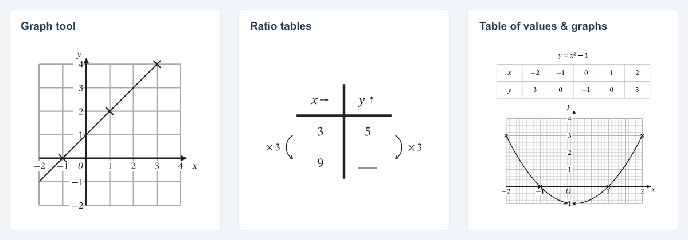
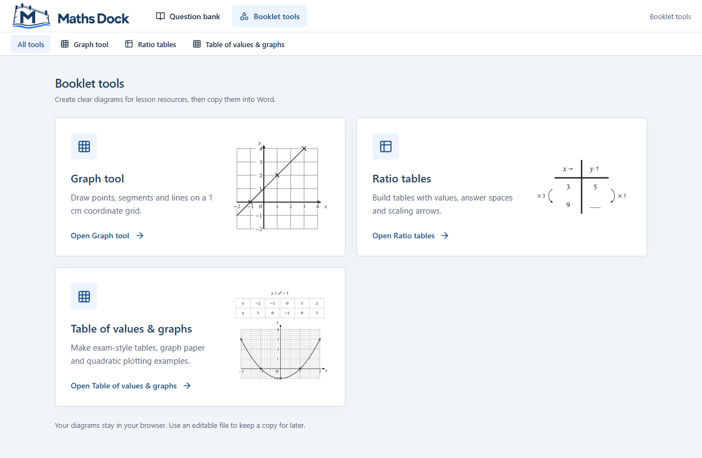

# All tools card previews

Every new MathsDock booklet tool should have both its small Lucide icon and a representative output image on the **All tools** page (`?tool=booklet-tools`). The icon supports recognition; the image lets a teacher see the classroom resource before opening the editor. Include the image in the tool's first release.

## Choose an honest example

Use one simple, mathematically correct example that shows the tool's distinctive output. It must remain recognisable at card size, rather than showing every feature. Keep deliberate pupil blanks and answer lines when they explain the teaching purpose.

The first three examples, created and published on 14 October 2026, are:

| Tool | Example | Editable source |
| --- | --- | --- |
| Graph tool | Coordinate grid, the line y = x + 1 and three plotted points | [Graph example](tool-card-preview-examples/graph-tool.json) |
| Ratio tables | 3 : 5 scaled by ×3, with 9 and a pupil answer line in the next row | [Ratio example](tool-card-preview-examples/ratio-tables.json) |
| Table of values & graphs | Five values of y = x² − 1, plotted points and its smooth quadratic curve | [Quadratic example](tool-card-preview-examples/table-of-values-and-graphs.json) |



## Generate the image from the tool

1. Save a small example in the tool's real editable format. Reopen it through its parser and check the mathematics, labels and intended blanks.
2. Render it through the same shared export renderer used by the tool. The original examples used `renderDiagramSvg`, `renderRatioSvg` and `renderSvg` from the graph, ratio-table and value-graph core packages respectively. Use the existing connector when available, or run the shared core locally and record that route. A connector failure must not be reported as a successful connector generation.
3. Keep only the pupil-facing artwork: no toolbar, handles, selection shading, warnings, browser frame, decorative illustration or invented output. Retain the tool's mathematical typography, grid weights and notation.
4. Export a closely cropped SVG on white, retaining complete labels, arrowheads and answer spaces. The original SVGs used `@resvg/resvg-js` with the bundled STIX Two Text regular/italic and STIX Two Math fonts, `loadSystemFonts: false`, then `toString()` to outline glyphs. Verify the resulting SVG needs no external font, image or service request.
5. Keep the editable example with the reference artwork. Generate a PNG from the final SVG when useful for review; the original review PNGs were 960 px wide. These web previews do not establish physical print dimensions or verified 600 ppi output. The tool's print-export checks remain separate.

Do not redraw a plausible thumbnail independently of the tool or use an AI illustration as evidence of its output. When the tool's output changes visibly, review and regenerate its preview from the saved example.

## Integrate through the shared registry and card

Store the website SVG at `src/assets/tool-previews/<tool-slug>.svg`. Import it in `src/site/registry.ts` and add `preview: { src, alt }` to the tool's existing `bookletTools` entry, alongside its stable ID, icon and editor component. For example, the ratio entry uses:

```tsx
import ratioPreview from "../assets/tool-previews/ratio-tables.svg";

// Within the existing Ratio tables registry entry:
preview: {
  src: ratioPreview,
  alt: "Example ratio table with multiplication arrows and a blank answer space."
}
```

The static import lets Vite include and fingerprint the SVG for the deployment's base path. Do not depend on an expiring connector download or a developer's local file path.

Reuse `Overview.tsx` and the `.overview-tool-*` styles in `src/site/site.css`:

- Keep the icon, title, description and Open link on the left; give the image roughly 40% of the card on the right.
- Keep two cards per row on wide screens. The original layout uses one column of cards at 900 px and below, then places the image beneath the text at 480 px and below.
- Reserve image space and use `object-fit: contain` so graphs and tables are neither stretched nor clipped. Centre naturally shorter artwork such as the ratio table within that space.
- Use one ordinary link for the whole card, including the image. Preserve keyboard focus, modified-click behaviour, existing routes and the Open label. Add concise alternative text describing the sample output; keep the icon decorative to assistive technology.
- Scope these styles to the booklet-tool cards so Home cards and editor exports retain their existing layout.



## Acceptance and release

- [ ] The SVG is actual tool output; the saved example reopens and its mathematics and pupil blanks are correct.
- [ ] The icon remains visible, and the sample is recognisable at its real card size.
- [ ] Alternative text is meaningful; keyboard focus is visible; clicking the image or text opens the correct tool.
- [ ] Desktop, tablet, 375 px and 320 px layouts have legible text, complete artwork and no horizontal page overflow. Review the longest tool name alongside the other cards.
- [ ] Navigation away and back still preserves existing tool work. Home cards remain unchanged.
- [ ] The built site contains the image at the correct base path. After an authorised release, its live bytes match the reviewed asset and the page actually loads it.
- [ ] Record the source commit, image-generation route, screenshots and checks actually run. Distinguish documentation/code changes, repository merge and website deployment.

Use the normal project release checks; this image convention does not authorise publication or change the print/export contract.

## Implementation record

The initial implementation is [commit 794ee8ff](https://github.com/tboughen/maths-booklet-tools/commit/794ee8fff0e4849e4c8a7639396d1b209428f451), on the `codex/tool-card-previews` release branch. It was deployed and verified at **mathsdock.co.uk**; a main-branch merge was not part of that release. If a checkout predates that shared card implementation, bring forward the registry, overview and scoped layout together before registering another preview. Check current production source rather than assuming GitHub main and the website are identical.

Original workspace evidence is retained in `reports/mathsdock-tool-card-previews-2026-10-14/` and editable/generation artifacts in `output/mathsdock-tool-previews-2026-10-14/`. These workspace paths are provenance, not runtime dependencies; the portable reference examples above travel with this guidance.
